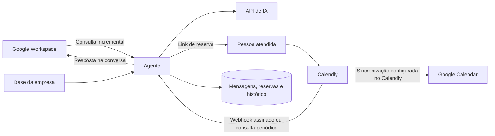

# Agente de e-mail profissional e Calendly

Serviço em Python/FastAPI que lê uma caixa Google Workspace, interpreta mensagens com IA, prepara ou envia respostas na mesma conversa e registra reservas do Calendly em SQLite.

O código está pronto para configuração e execução. Contas, domínio, credenciais e hospedagem precisam ser conectados pelo proprietário. O aplicativo usa credenciais próprias no servidor.

## Funcionamento



- O Gmail usa OAuth e acompanha alterações por `historyId`, com recuperação quando o histórico expira.
- A IA responde perguntas usando `knowledge/company.md`; dúvidas sem informações suficientes ficam para revisão humana.
- Para agendar, o agente envia o link do Calendly. A reserva é registrada após confirmação pela API ou notificação assinada.
- Para alterar uma reserva futura, usa o link oficial vinculado ao e-mail do remetente. Casos com múltiplas reservas ficam para revisão humana.
- Cancelamentos e reagendamentos preservam o vínculo entre reservas, mesmo com notificações fora de ordem.
- O Calendly cria e atualiza os eventos no calendário conectado. O serviço também permite consultar os horários ocupados do Google Calendar.
- Contatos, conversas, respostas, reservas, tentativas e falhas ficam em armazenamento persistente.

## Executar localmente

Requisitos: Python 3.11+ e Linux/macOS/WSL. Execute a partir da raiz do repositório.

```bash
python -m venv .venv
source .venv/bin/activate
python -m pip install -c requirements.lock -e '.[dev]'
python scripts/init_env.py
```

Edite `.env` com os dados reais da empresa e das integrações. O script gera os tokens administrativo e de assinatura sem mostrá-los no terminal. Preencha `knowledge/company.md` com informações autorizadas.

```bash
uvicorn agent.main:app --host 127.0.0.1 --port 8000 --workers 1
```

```bash
curl http://127.0.0.1:8000/health
```

O serviço pode iniciar com configuração incompleta para permitir inspeção; os fluxos correspondentes aguardam as credenciais. Em `/docs`, use **Authorize** com `ADMIN_API_TOKEN` e consulte `GET /api/status` para verificar pendências. `/health` verifica somente se o processo está ativo.

`AUTO_SEND=false` gera rascunhos no banco local, disponíveis em `GET /api/outbox`. Depois de conectar e validar as contas, configure `AUTO_SEND=true` e reinicie para enviar novas respostas automaticamente. Rascunhos anteriores podem ser liberados individualmente pela API.

## Conectar e-mail e calendário

1. Tenha um domínio próprio e uma caixa Google Workspace, como `assistente@suaempresa.com`. Configure MX, SPF, DKIM e DMARC conforme os provedores do domínio e do e-mail.
2. No Google Cloud, habilite **Gmail API** e **Google Calendar API**, configure a tela de consentimento e crie um cliente OAuth do tipo **Desktop app**.
3. Preencha `GOOGLE_CLIENT_ID`, `GOOGLE_CLIENT_SECRET` e `AGENT_EMAIL`. Use o endereço principal da caixa que será autorizada.
4. No computador que possui o navegador, execute:

   ```bash
   python scripts/google_oauth.py
   ```

   O script abre o consentimento com PKCE e callback local, pede acesso de leitura/envio do Gmail e leitura do calendário, e grava `GOOGLE_REFRESH_TOKEN` apenas no `.env`. Transfira a configuração para o gerenciador de segredos do servidor quando necessário.

5. Conecte o calendário ao Calendly, selecione os calendários usados para checar conflitos e o calendário que receberá os eventos. Configure tipos de reunião, duração, intervalos e disponibilidade no Calendly.
6. Preencha `CALENDLY_SCHEDULING_URL` e `GOOGLE_CALENDAR_ID` (`primary` por padrão).

Aplicativos Google externos em modo de teste podem receber refresh tokens de curta duração. Para operação contínua, configure corretamente o público e a publicação do aplicativo, seguindo as exigências do Google e da sua organização.

## Conectar o Calendly

Crie um token pessoal no Calendly e preencha `CALENDLY_API_TOKEN`. A consulta periódica recupera reservas e participantes ativos/cancelados, dentro da janela definida por `CALENDLY_LOOKBACK_DAYS` e `CALENDLY_AHEAD_DAYS`.

Para receber alterações imediatamente, disponibilize o serviço por HTTPS e registre:

```bash
python scripts/register_calendly_webhook.py --url https://seu-host/webhooks/calendly
```

O script registra `invitee.created` e `invitee.canceled` no escopo do usuário, usando a chave definida em `.env`. O servidor deve usar essa mesma chave. O endpoint valida HMAC, expiração e tamanho, persiste a notificação antes de responder e processa a reserva no próximo ciclo.

A disponibilidade de API/webhooks depende do plano e das permissões do Calendly. Quando a conta permitir leitura por API, a consulta periódica funciona sem webhook. `CALENDLY_SYNC_SECONDS` controla o intervalo; falhas recebem espera progressiva.

## Conectar a IA

Preencha `OPENAI_API_KEY` e escolha um modelo com suporte a Structured Outputs em `OPENAI_MODEL`. A implementação usa Chat Completions com JSON Schema; o modelo padrão é configurável.

Cadastre na base da empresa informações verificadas, como serviços, preços autorizados, horários e políticas. Mensagens recebidas e histórico são enviados à API de IA para classificação e elaboração da resposta. Anexos não são processados.

## API de operação

Todas as rotas `/api/*` exigem `Authorization: Bearer <ADMIN_API_TOKEN>`.

| Método e rota | Uso |
| --- | --- |
| `GET /health` | Verificar processo ativo |
| `GET /api/status` | Modo, pendências, filas e falhas recentes |
| `POST /api/run` | Executar um ciclo, com bloqueio contra sobreposição |
| `GET /api/messages` | Mensagens e itens para revisão humana |
| `GET /api/outbox` | Rascunhos e resultados dos envios |
| `GET /api/bookings` | Reservas com data, fuso e status |
| `GET /api/contacts` | Contatos conhecidos |
| `GET /api/audit` | Histórico de ações e falhas |
| `POST /api/outbox/{message_id}/approve` | Liberar um rascunho quando `AUTO_SEND=true` |
| `POST /api/messages/{message_id}/retry` | Reavaliar um item humano após corrigir a base/configuração |
| `POST /api/notifications/{id}/retry` | Retomar uma notificação após falhas persistentes |
| `POST /api/availability` | Consultar horários ocupados no Google Calendar |
| `POST /webhooks/calendly` | Receber notificação com assinatura do Calendly |

Exemplo de corpo para consultar o calendário:

```json
{
  "start": "2026-10-22T09:00:00-03:00",
  "end": "2026-10-22T18:00:00-03:00"
}
```

As listagens aceitam `limit` entre 1 e 200. As datas das reservas são normalizadas para UTC e preservam o fuso informado pelo convidado. A página do Calendly verifica a disponibilidade final da reserva.

## Falhas e continuidade

O agente ignora mensagens do próprio endereço, respostas automáticas e listas, conserva o contexto da conversa e responde ao remetente. Solicitações sem contexto suficiente ficam em `human`; consulte mensagens e auditoria para tratá-las.

Envios usam uma fila persistente e um `Message-ID` estável. Um envio com timeout, resposta ambígua ou interrupção fica em `uncertain`. O serviço procura esse identificador na pasta de enviados e registra a entrega quando o encontra. Enquanto o resultado permanecer incerto, o item aguarda revisão humana. O Gmail não oferece uma garantia geral de envio exatamente uma vez.

Limites de envio (`429`) recebem novas tentativas com espera. Erros definitivos de permissão ficam em `failed`. Notificações do Calendly recebem até oito tentativas e podem ser retomadas pela API após corrigir o problema. A consulta periódica complementa a recuperação de eventos perdidos dentro da janela configurada.

O SQLite exige **uma instância, um worker e armazenamento persistente**. O bloqueio de arquivo impede dois processos no mesmo banco. Reinícios recuperam as filas, incluindo envios que precisam de reconciliação. Faça backup consistente do SQLite, por exemplo com sua API de backup, e mantenha o banco fora do Git. Mensagens e dados pessoais permanecem no armazenamento: aplique a política de retenção da empresa.

## Executar em servidor

```bash
docker compose up --build -d
```

O Compose mantém o banco em um volume e publica a porta apenas em `127.0.0.1:8000`. Configure um proxy HTTPS para receber os webhooks externamente. O agente precisa permanecer ativo para acompanhar mensagens; GitHub armazena o projeto e executa as verificações de código.

Os arquivos de contêiner estão incluídos; a validação principal roda diretamente em Python. Não há implantação automática em uma conta de hospedagem.

## Usar o n8n

O worker interno executa os ciclos. Para usar n8n como agendador:

1. Configure `RUN_WORKER=false` no agente.
2. Importe `n8n/run-agent.json` no n8n.
3. Substitua a URL do nó HTTP pelo endereço do agente.
4. Configure uma credencial **Header Auth**: nome `Authorization`, valor `Bearer <ADMIN_API_TOKEN>`.
5. Teste e ative o workflow. Ajuste o timeout se o volume de mensagens exigir.

O workflow é fornecido como configuração de integração; sua importação e execução precisam ser verificadas na instância n8n utilizada.

## Verificação

```bash
ruff check .
ruff format --check .
pytest -q
```

A suíte usa contas e transportes HTTP simulados para testar recebimento, MIME, OAuth, histórico/paginação, respostas, duplicidades, webhooks, cancelamento, reagendamento, falhas e reconciliação de envios. A ação do GitHub está configurada para Python 3.11 e 3.12.

Antes de operar a caixa profissional, faça um ensaio com caixa e calendário de teste: receba uma mensagem, confira o rascunho, ative o envio, reserve pelo Calendly e verifique registro, cancelamento e reagendamento. As verificações locais não usam credenciais reais nem enviam mensagens.

Documentação oficial: [Gmail API](https://developers.google.com/workspace/gmail/api/guides), [Google Calendar API](https://developers.google.com/workspace/calendar/api/guides/overview), [OAuth para aplicativos locais](https://developers.google.com/identity/protocols/oauth2/native-app), [Calendly API](https://developer.calendly.com/), [Structured Outputs](https://platform.openai.com/docs/guides/structured-outputs).
