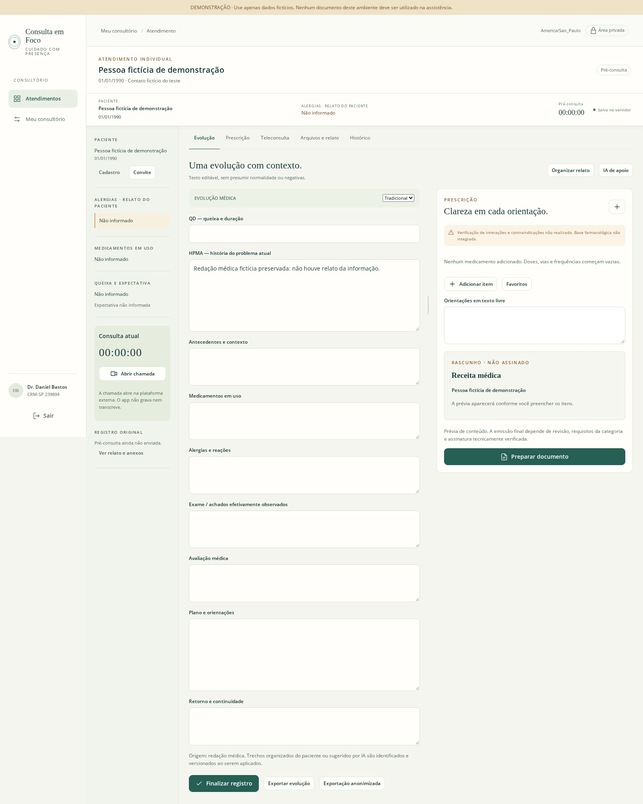
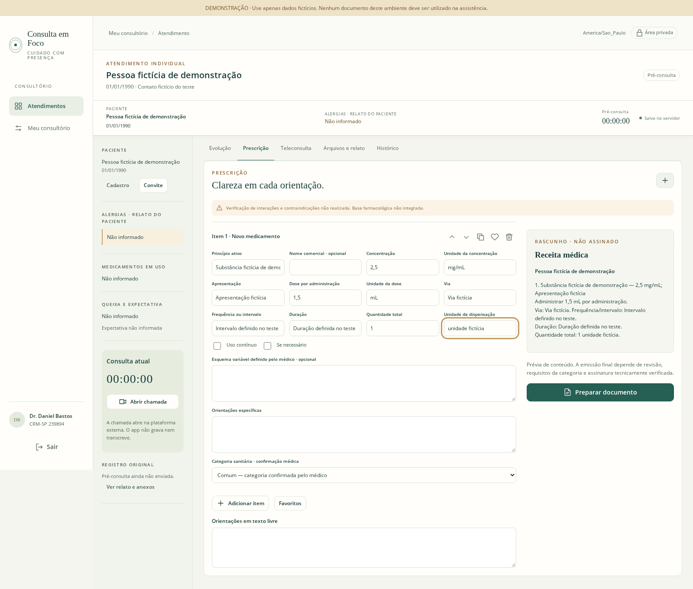

# Demonstração e testes

## Percurso manual

1. Inicie python -m consulta.cli demo e escolha **Abrir demonstração vazia**.
2. Em **Meu consultório**, preencha aviso de privacidade fictício.
3. Crie paciente fictício e HPMA. Aguarde **Salvo no servidor**; recarregue e confira a redação.
4. Adicione medicamento fictício com campos explícitos. Concentração 2,5 mg/mL e dose 1,5 mL continuam distintas.
5. Abra convite em janela privada. Preencha negativas explícitas e “não sabe”. Campos internos médicos não aparecem.
6. Envie e atualize a página médica. **Organizar relato** compara antes de aplicar.
7. Edite em duas abas. Salve uma e tente salvar revisão antiga na outra: conflito preserva o texto.
8. Registre teleconsulta, identidade, consentimento, início/término, avaliação e plano. Finalização preserva registro; complementações são adendos.
9. Baixe documento de rascunho. Em ambiente configurado, revisão → PDF final → assinatura externa → verificação → liberação são etapas distintas.
10. Revogue convite e confira acesso encerrado. Retorno mantém vínculo/histórico, iniciando relato/redação vazios.

Use somente dados fictícios. A demonstração é removida ao encerrar o servidor.

## Ensaios automatizados

Linux, Python 3.12, requirements.lock e Chromium/Playwright, com dados e PKI fictícios:

~~~bash
ruff check .
ruff format --check .
node --check consulta/web/app.js
RUN_BROWSER_TESTS=1 pytest -q
~~~

Navegador testa um processo real em porta temporária e o encerra ao terminar. Capturas ficam em test-results, ignorado pelo Git.

| Grupo | Verificações |
| --- | --- |
| Acesso | Anônimo, outro médico/paciente, documento não liberado, CSRF/origem e convites expirados/revogados |
| Persistência | Rascunho após nova instância, concorrência, negativas e estados distintos |
| Histórico | Consentimento não presumido, finalização, adendos e retorno vazio |
| Documentos | Decimais, favoritos, revisão, categorias bloqueadas, PDF longo e exportação de evolução |
| Assinatura | PKI sintética, titular incorreto, ausência de confiança, revogação e alteração de bytes |
| Entrega | Bytes assinados idênticos e acesso revogado |
| Dados | Cifragem, auditoria sem narrativa, upload inválido recusado, anonimização com JSON íntegro |
| Continuidade | Backup/restauração, sessões invalidadas e corrupção recusada |
| Navegador | Médico/paciente separados, recarga, falha/repetição de rede, duas abas, PDF, 1600 px e 390 px sem transbordamento horizontal |

Sem envio real, credencial de IA, Calendly ou ICP-Brasil real. Ensaios não são auditoria externa, certificação WCAG, teste de carga ou homologação clínica/sanitária.

CI repete análise estática e testes com navegador nas versões declaradas. Resultados ficam no GitHub Actions; o resultado local será registrado nesta entrega.

## Resultado local — 22/10/2026

- 46 testes passaram, incluindo o ensaio de navegador, em 32,74 s.
- Ruff sem erros, 25 arquivos Python com formatação conferida e JavaScript validado com node --check.
- pip check sem incompatibilidades; wheel construído com interface e fontes locais incluídas.
- Um aviso de descontinuação da compatibilidade Starlette/httpx no TestClient; não houve falha de teste. A aplicação não usa TestClient em operação.
- IA: também testados provedor indisponível e retorno simulado, sem envio real; nenhum retorno aplicou conteúdo ao registro automaticamente.

## Capturas da demonstração

Somente dados fictícios. As capturas mostram o aplicativo em execução; não representam atendimento real ou prontuário em produção.

[Pré-consulta no celular](screenshots/patient-mobile.png).
